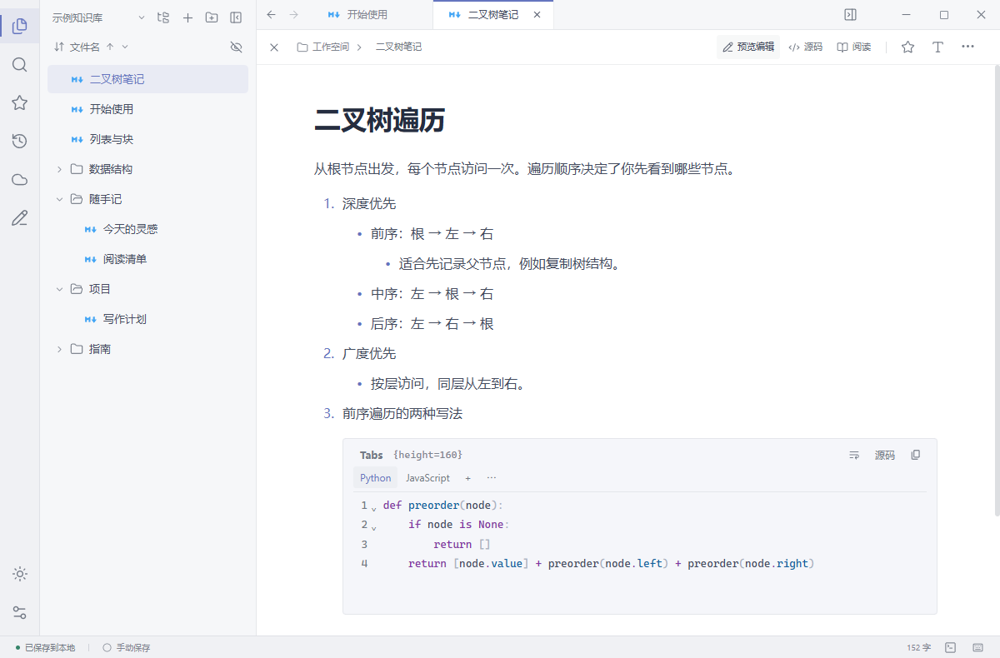

# Lenslet

Lenslet 是一款本地优先的 Markdown 编辑器。笔记保存在普通文件夹，可通过 WebDAV 在设备间同步。

[下载 Lenslet](https://github.com/JJl624/Lenslet/releases/latest)

- **写作与阅读**　在预览编辑、源码和阅读之间切换，支持多级列表、数学公式、Mermaid 和折叠引用。
- **代码笔记**　用标签页整理代码，在桌面运行代码，还能把交互式 HTML 钉在正文里。
- **内嵌附件**　桌面版可在笔记中阅读 PDF、预览 Excalidraw 绘图和播放乐谱。

[反馈问题](https://github.com/JJl624/Lenslet/issues)、[开发与维护](docs/maintenance-handbook.md)、[MIT 许可证](LICENSE)
